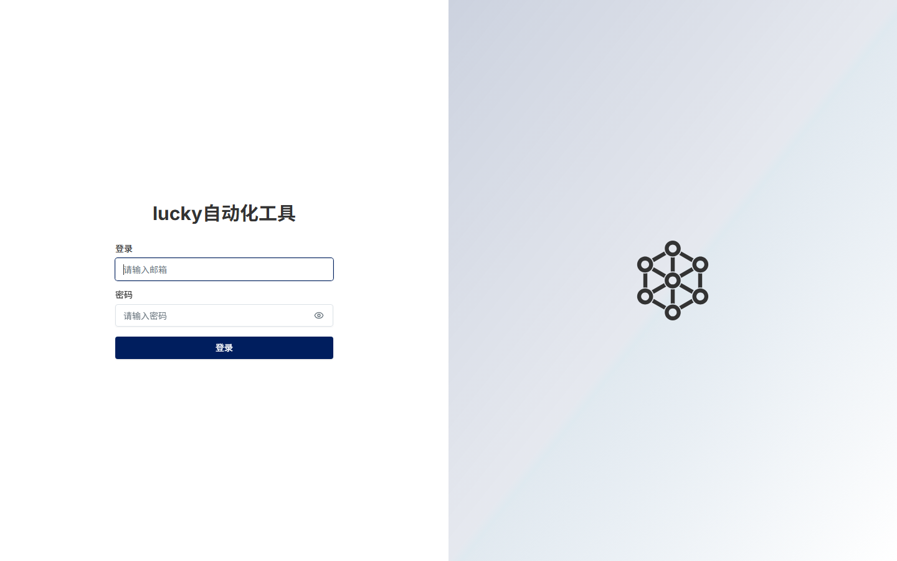
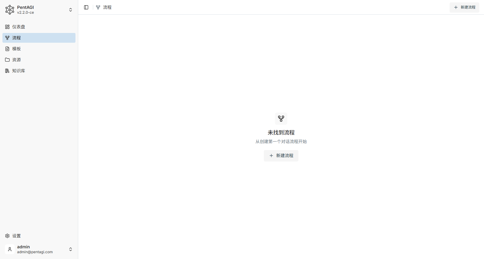

<div align="center">

# lucky自动化工具

**基于 PentAGI 的中文自动化渗透测试平台 · Windows 一键部署**

简体中文界面 · 自带浏览器 · 本地向量嵌入 · 无需外部 embedding 供应商

</div>

---

## 这是什么

[PentAGI](https://github.com/vxcontrol/pentagi) 是一个开源的自主渗透测试多智能体系统：你用自然语言描述目标，一组 AI 智能体规划工作、在隔离容器里跑 nmap / Metasploit / sqlmap 等工具，最后产出报告。

它的官方界面只有英文，而且依赖两个较重的 Docker 镜像（网页抓取器 `vxcontrol/scraper`、向量嵌入供应商）。这个仓库解决三件事：

| 问题 | 本仓库的做法 |
|---|---|
| 界面全英文 | **运行时注入中文层**，878 条词表，不改官方镜像一个字节 |
| `vxcontrol/scraper` 拉不下来 / 想自控 | 用工信契约自己实现：`GET /markdown|/html|/links|/screenshot`，Playwright + Chrome 渲染 |
| 需要 OpenAI 等 embedding Key | 本地 fastembed 服务，OpenAI 兼容 `/v1/embeddings`，384 维多语言模型 |

在 Windows 11 上从零到能用，只需一条命令 + 一次重启。

## 界面预览

| 登录 | 主界面 |
|---|---|
|  |  |

> 截图占位：安装后可自行替换 `assets/` 下的图片。

## 前置条件

- **Windows 11**（build 22000+）或 Windows 10 21H2+
- BIOS 中已开启 CPU 虚拟化（VT-x / AMD-V）
- 至少 **8 GB** 内存、**20 GB** 可用磁盘
- 能访问互联网（会下载约 700 MB 运行时依赖）
- 管理员权限

不需要你预先装 Docker、WSL、Python、Git。

## 快速开始

### 1. 下载

```powershell
git clone https://github.com/001ship/luckypen.git
cd luckypen
```

没有 git 也可以：右上角 **Code → Download ZIP**，解压后进目录。

### 2. 安装

以**管理员身份**打开 PowerShell（开始菜单搜 PowerShell → 右键「以管理员身份运行」），执行：

```powershell
powershell -NoProfile -ExecutionPolicy Bypass -File .\install.ps1 -DeepSeekKey sk-你的密钥
```

> **为什么用这行而不是直接 `.\install.ps1`**：Windows 默认执行策略会拦截未签名脚本，报「无法加载，因为在此系统上禁止运行脚本」。`-ExecutionPolicy Bypass` 只对本次进程生效，不改系统设置。

> 没有 DeepSeek Key 也可以先装：去掉 `-DeepSeekKey sk-xxx` 即可，装完编辑 `C:\pentagi\.env` 补上，再重启容器。
> 脚本会自动提权，全程有进度输出。

### 3. 重启

阶段 1 会启用 WSL2 并下载依赖，然后提示重启。**重启后会自动继续**（已注册登录任务）。

如果没自动继续，手动再跑一次：

```powershell
.\install.ps1
```

### 4. 登录

```
地址: https://127.0.0.1:8443
账号: admin@pentagi.com
密码: admin
```

浏览器会提示自签证书，点「继续访问」即可。**首次登录会强制修改密码。**

## 安装过程做了什么

```
install.ps1
├── 阶段 1（需重启）
│   ├── 启用 Microsoft-Windows-Subsystem-Linux + VirtualMachinePlatform
│   ├── 安装 WSL2 内核 (wsl_update_x64.msi)
│   ├── 下载 Ubuntu 24.04 rootfs (340 MB)
│   ├── 生成 .env（随机 COOKIE_SIGNING_SALT / 数据库密码）
│   └── 注册重启后继续的任务
└── 阶段 2（重启后自动）
    ├── 导入 WSL 发行版 PentAGI -> C:\pentagi\wsl
    ├── 装 Docker Engine（强制 iptables-legacy，WSL 内核必需）
    ├── 装 Python venv + fastembed + playwright
    ├── 下载 Chrome for Testing (208 MB)
    ├── 拉 PentAGI 镜像并启动
    ├── 导出前端产物 -> 注入中文层 -> 挂载重建
    └── 注册开机自启 + 配置端口转发
```

## 目录结构

```
luckypen/
├── install.ps1                  一键安装（两阶段）
├── config/
│   ├── docker-compose.yml       PentAGI 编排（含前端挂载、host-gateway）
│   └── .env.example             配置模板（342 项）
├── i18n/
│   ├── dict.js                  878 条英中词表
│   ├── inject.js                运行时注入层
│   └── tools/                   词表维护工具（提取/分类/覆盖率扫描）
├── services/
│   ├── scraper/server.py        自建网页抓取器
│   └── embedding/server.py      自建向量嵌入服务
├── scripts/
│   ├── lib/common.ps1           公共函数
│   ├── pentagi-startup.ps1      开机启动
│   └── wsl/                     WSL 内分步脚本
└── docs/TROUBLESHOOTING.md      故障排查
```

## 汉化是怎么做的

官方前端没有 i18n 框架，英文硬编码在 97 个打包 chunk 里，且与 Tailwind 类名、GraphQL 字段名混在一起——直接改 JS 会破坏逻辑。

所以采用 **DOM 层运行时翻译**：

```js
// 概念示意
MutationObserver -> 发现新节点 -> 查词表 -> 替换文本/placeholder/title
```

- 不修改原始 bundle，升级官方镜像不受影响
- React 每次重渲染会写回英文，观察者持续校正
- 覆盖文本节点 + `placeholder` / `title` / `aria-label` / `alt`
- 日期、相对时间、`build xxx` 走正则规则，不进词表
- 外链里的 `github.com/vxcontrol/pentagi` 自动改写为本仓库地址

**改词表**：编辑 `i18n/dict.js`，然后同步进容器：

```powershell
wsl -d PentAGI -u root -- cp /mnt/c/pentagi/fe/i18n-dict.js /opt/pentagi/fe-cn/i18n-dict.js
```

改完刷新浏览器即可，无需重启。

## 内置浏览器

PentAGI 的 browser 工具会向 scraper 发四个请求，我们按同样契约实现：

```
GET /markdown?url=<target>            -> text/markdown
GET /html?url=<target>                -> text/html
GET /links?url=<target>               -> [{"Title","Link"}, ...]
GET /screenshot?fullPage=true&url=... -> image/png
```

实现要点：

- **Playwright + Chrome for Testing**：真实渲染 JS 站点，不是简单 HTTP 抓取
- **单线程服务**：Playwright sync API 绑定创建线程，多线程会报 `Cannot switch to a different thread`
- Chrome 从 `storage.googleapis.com` 下载（playwright 官方 CDN 常中断），通过 `SCRAPER_CHROME` 指定路径

## 向量嵌入

本地跑 `paraphrase-multilingual-MiniLM-L12-v2`（384 维，多语言），暴露 OpenAI 兼容接口：

```bash
curl -X POST http://127.0.0.1:8080/v1/embeddings \
  -H 'Content-Type: application/json' \
  -d '{"input":"渗透测试目标","model":"paraphrase-multilingual-MiniLM-L12-v2"}'
```

PentAGI 侧配置：

```bash
EMBEDDING_PROVIDER=openai
EMBEDDING_URL=http://host.docker.internal:8080/v1
EMBEDDING_KEY=local-embed
EMBEDDING_MODEL=sentence-transformers/paraphrase-multilingual-MiniLM-L12-v2
```

模型经 `hf-mirror.com` 下载。想换模型改 `.env` 里的 `EMBEDDING_MODEL`（需在 fastembed 支持列表内），同时改 `scripts/wsl/start-stack.sh` 的 `EMBED_MODEL`。

## 常用操作

```powershell
# 查看状态
wsl -d PentAGI -u root -- docker ps
wsl -d PentAGI -u root -- curl -s http://127.0.0.1:8080/health   # embedding
wsl -d PentAGI -u root -- curl -s http://127.0.0.1:8081/health   # scraper

# 重启全栈
.\scripts\pentagi-startup.ps1

# 只看容器日志
wsl -d PentAGI -u root -- docker logs pentagi --tail 100

# 改配置后重载
notepad C:\pentagi\.env
wsl -d PentAGI -u root -- bash -lc "cd /opt/pentagi && docker compose up -d pentagi"

# 卸载
schtasks /Delete /TN "PentAGI Stack Boot" /F
schtasks /Delete /TN "PentAGI Stack Startup" /F
wsl --unregister PentAGI
```

## 配置说明

安装后配置文件在 `C:\pentagi\.env`，关键项：

| 变量 | 说明 |
|---|---|
| `PENTAGI_LISTEN_IP` | 默认 `127.0.0.1` 仅本机；局域网访问改 `0.0.0.0` |
| `PENTAGI_LISTEN_PORT` | 默认 `8443` |
| `DEEPSEEK_API_KEY` | 主 LLM。也支持 `OPEN_AI_KEY` / `ANTHROPIC_API_KEY` / `GEMINI_API_KEY` 等 |
| `EMBEDDING_*` | 向量嵌入端点 |
| `SCRAPER_*_URL` | 抓取器地址 |
| `DUCKDUCKGO_ENABLED` | 内置搜索（无需 Key） |

> 公网暴露前务必配置 TLS 与反向代理；默认绑 `127.0.0.1` 就是为了避免裸奔。

## 故障排查

见 [docs/TROUBLESHOOTING.md](docs/TROUBLESHOOTING.md)，涵盖：

- WSL 内核缺失 / 发行版导入失败
- dockerd 启动失败（`chain PREROUTING`、nft nat）
- 镜像拉不下来（加速源选择）
- 浏览器打不开 / 端口转发失效
- scraper 或 embedding 不健康

## 许可与声明

- 本仓库代码（安装脚本、语言包、两个 sidecar 服务）：**MIT**
- **PentAGI 本体**版权归 PentAGI Development Team，采用 MIT + EULA。本项目在部署时从其**官方 Docker Hub 拉取镜像**，不重新分发镜像或前端产物
- 本项目为**非官方**中文部署方案，与 PentAGI Development Team 无隶属关系，未获其背书
- 请仅将本工具用于**获得明确授权的**渗透测试与安全评估

使用前请阅读 PentAGI 的 [LICENSE](https://github.com/vxcontrol/pentagi/blob/main/LICENSE) 与 [EULA](https://github.com/vxcontrol/pentagi/blob/main/EULA.md)。
